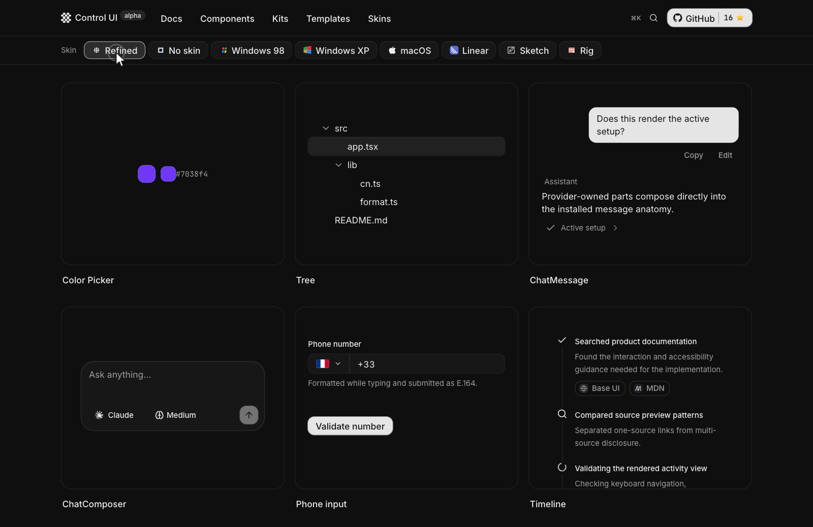

# Control UI

React components for shadcn/ui and Tailwind CSS v4. One component source, ten skins, from a neutral default to Windows XP.

<p align="center">
  <a href="https://control-ui.dev/skins">
    
  </a>
</p>

```bash
npx shadcn@latest add https://control-ui.dev/r/all.json
```

[](https://www.npmjs.com/package/@ctrl-ui/react)
[](./LICENSE)
[](https://control-ui.dev)

[Documentation](https://control-ui.dev) · [Get started](https://control-ui.dev/get-started) · [Components](https://control-ui.dev/components) · [Skins](https://control-ui.dev/skins) · [Report an issue](https://github.com/damien-schneider/control-ui/issues)

Control UI is a registry of 100+ components, kits, and templates: form controls and pickers, trees and navigation, code and markdown editors, canvases and node graphs, complete app screens, and the chat and coding-agent surfaces AI products need. The shadcn CLI copies the source into your app, so you own it and can edit it. The same set also ships as the `@ctrl-ui/react` package.

> [!NOTE]
> Control UI is in alpha. The catalog labels each item stable, beta, or experimental; beta and experimental APIs can still change.

## Why Control UI

- **You own the source.** Components land in your repository. Your customizations live in the skin layer, so an update never overwrites them.
- **No runtime lock-in.** Components take plain props, children, and callbacks. Model calls, streaming, persistence, and transport stay in your app.
- **Skins change the whole system.** A skin is three files: tokens, component knobs, and an optional config. Swapping it restyles every component without forking markup or behavior.
- **Install at the size you need.** One component, a kit of related parts, a complete template, or everything.
- **Lives next to shadcn/ui.** Control UI installs under `components/control-ui/*` and never touches `components/ui/*`. Root and `src/` layouts both work through your shadcn aliases.

## Quick start

You need a React 19 app with shadcn and Tailwind CSS v4 set up.

1. Install a component:

   ```bash
   npx shadcn@latest add https://control-ui.dev/r/chat-message.json
   ```

2. Import the styles once in `app/globals.css` (or `src/app/globals.css`):

   ```css
   @import "tailwindcss";
   @import "../components/control-ui/styles/theme.css";
   @import "../components/control-ui/styles/effects.css";
   ```

3. Render it:

   ```tsx
   import type { ReactNode } from "react";

   import {
     ChatMessage,
     ChatMessageBody,
     ChatMessageContent,
     ChatMessageRow,
   } from "@/components/control-ui/chat-message";

   export function AssistantMessage({ children }: { children: ReactNode }) {
     return (
       <ChatMessage from="assistant">
         <ChatMessageRow>
           <ChatMessageBody>
             <ChatMessageContent>{children}</ChatMessageContent>
           </ChatMessageBody>
         </ChatMessageRow>
       </ChatMessage>
     );
   }
   ```

Core ships neutral light and dark defaults, so a skin is optional. Installing a skin replaces only the active skin files, never component source. For a complete chat screen, install the template instead:

```bash
npx shadcn@latest add https://control-ui.dev/r/chat-block.json
```

The [getting-started guide](https://control-ui.dev/get-started) covers skins, provider integrations, CSS setup, and migrations.

### Prefer a package?

`@ctrl-ui/react` ships the same components with neutral defaults and no skin presets. Import paths mirror the registry tree: replace `@/components/control-ui/` with `@ctrl-ui/react/` and the examples above work unchanged.

```bash
npm install @ctrl-ui/react
```

```css
@import "tailwindcss";
@import "@ctrl-ui/react/styles/index.css";
@source "../node_modules/@ctrl-ui/react/dist";
@source not "../node_modules/@ctrl-ui/react/dist/docs";
```

Theme it by setting tokens in your own CSS, or pass a skin config through the optional `SkinProvider`. Pick the registry instead when you want to edit component source. The [package README](./packages/components/README.md) lists its lint rules and optional peers.

## Built for coding agents

Every install includes what an agent needs to use the components correctly, so it does not have to guess from the docs site.

- **Docs beside the source.** Each component installs with `docs/<id>.md`: exports, composition, a usage example, anatomy, and knobs, matching the installed version.
- **An agent skill.** Every skin pack installs `.claude/skills/control-ui` with the token contract and the working rules. Updates refresh it.
- **An MCP server.** Search, inspect, and install from the registry:

  ```bash
  claude mcp add --transport http control-ui https://control-ui.dev/api/mcp
  ```

- **Machine-readable docs.** [`/llms.txt`](https://control-ui.dev/llms.txt), [`/llms-full.txt`](https://control-ui.dev/llms-full.txt), the [agent index](https://control-ui.dev/r/agent-index.json), and any docs page as markdown with `Accept: text/markdown`.

## Explore the catalog

- [Components](https://control-ui.dev/components): controls, pickers, navigation, layout, code, and canvas building blocks.
- [Kits](https://control-ui.dev/kits): related parts installed together, for messages, composers, activities, attachments, citations, and tasks.
- [Templates](https://control-ui.dev/templates): complete settings, file explorer, design canvas, team chat, chat, and coding-agent screens.
- [Skins](https://control-ui.dev/skins): Refined, Windows XP, Windows 98, Linear, Mastra, and more, all on one component contract.

## Contributing

Bug reports, proposals, docs fixes, and new components are welcome. [CONTRIBUTING.md](./CONTRIBUTING.md) covers local setup, how the repository is organized, and the checks a pull request must pass. Security issues go through [SECURITY.md](./SECURITY.md), not public issues.

## License

[MIT](./LICENSE). Releases and breaking changes are listed in the [changelog](./CHANGELOG.md).

The pixel font in the Windows XP and Windows 98 skins comes from [XP.css](https://github.com/botoxparty/XP.css) and [98.css](https://github.com/jdan/98.css), both MIT. Windows is a trademark of Microsoft and macOS a trademark of Apple; Control UI is not affiliated with either, and its skins are recreated in CSS.
